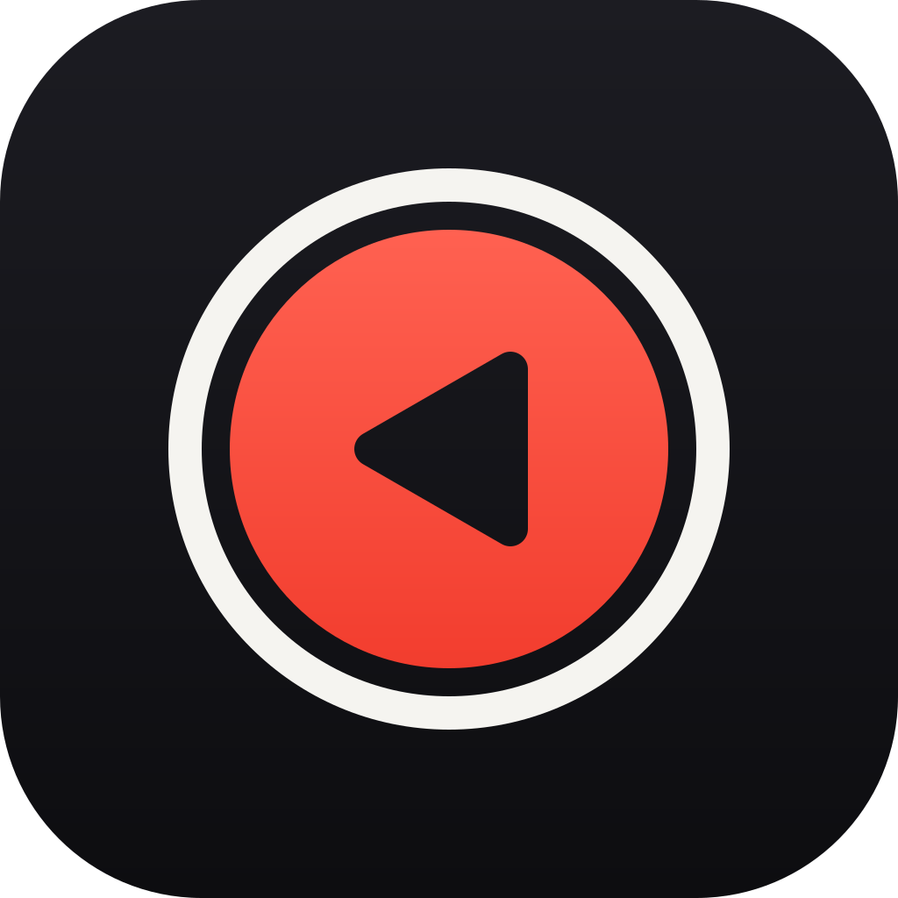
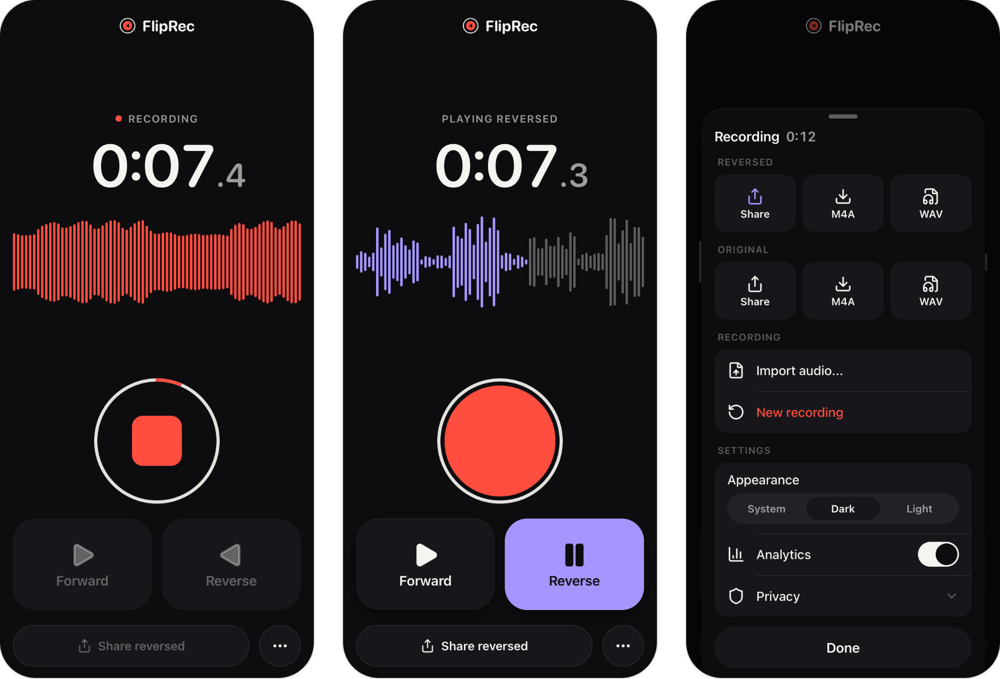

  

<h1 align="center">FlipRec</h1>

  Record your voice and play it backwards, right in your browser. 
  <a href="https://tmrk.github.io/fliprec/"><strong>Open FlipRec</strong></a>

  

FlipRec is a small voice recorder with one trick: it plays your recording backwards. Tap the big
red button, say something, tap it again to stop, then listen forwards or in reverse. If it sounds
funny, send the reversed clip to a friend.

Everything happens in your browser. Nothing you record is uploaded.

## How to use it

1. Open [tmrk.github.io/fliprec](https://tmrk.github.io/fliprec/) on your phone or computer.
2. Tap the red button and allow microphone access. Tap it again to stop. A recording can be up
   to two minutes long.
3. Tap Forward or Reverse to listen, and tap again to pause. Drag across the waveform to jump to
   another point.
4. Tap Share reversed to send the backwards version through your phone's share sheet, for example
   to WhatsApp or Messages.

The More button (three dots) has everything else. You can share or save the original, save either
version as an M4A or WAV file, open an audio file from your device, start a new recording, and
switch between light and dark mode.

## Install it on your phone

FlipRec can be added to your home screen. It then opens like an app and keeps working without
an internet connection.

- iPhone and iPad: open FlipRec in Safari, tap the Share button, then Add to Home Screen.
- Android: open FlipRec in Chrome, open the menu, then Install app or Add to Home screen.

## Audio files

Shared and saved recordings are standard M4A files with AAC audio, the same format as voice memos
on an iPhone. They play on iPhone, Android, Mac and Windows, and you can send them through
WhatsApp, Messages, AirDrop or email. Files are named after the time you recorded them, for
example `fliprec-reversed-20261027-093000.m4a`. WAV is there too if you need uncompressed audio.

## Privacy

- Your recordings never leave your device. Recording, reversing and converting all happen in the
  browser.
- There is no account and no cloud storage.
- Your latest recording is kept in this browser so it is still there after a reload. New recording
  deletes it.
- FlipRec may ask whether it can collect anonymous usage statistics, such as how often recordings
  are played in reverse. Nothing is collected unless you allow it, and you can change your mind at
  any time in the More menu. Audio, file names and anything you say are never included.

## Browser support

FlipRec is built for current versions of Safari on iPhone, iPad and Mac, and for Chrome, Edge and
Firefox. Sharing files directly depends on your browser and system. Where it isn't available,
FlipRec saves the file to your device instead.

## License

FlipRec is released under the [MIT License](LICENSE). It uses
[Mediabunny](https://github.com/Vanilagy/mediabunny) (MPL-2.0) to create audio files, including an
AAC encoder built from [FFmpeg](https://ffmpeg.org) (LGPL-2.1).
